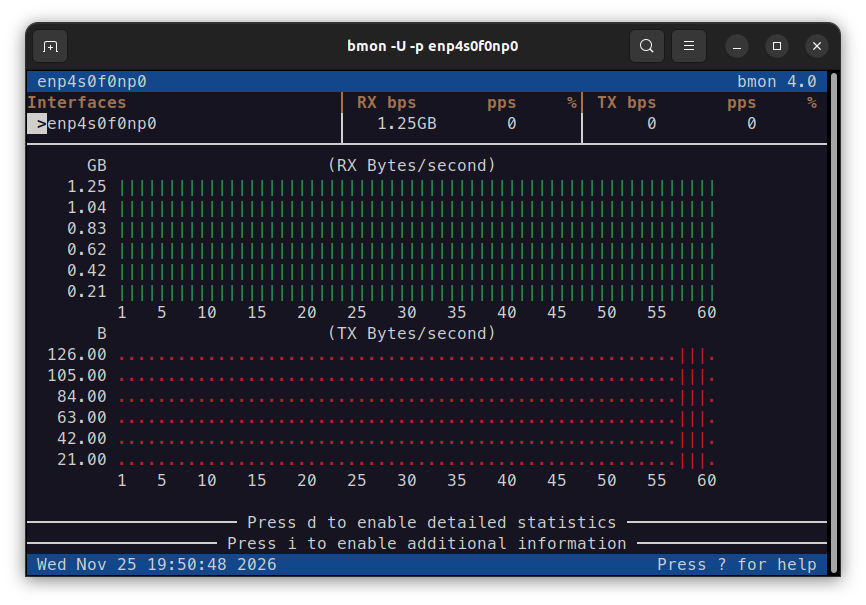
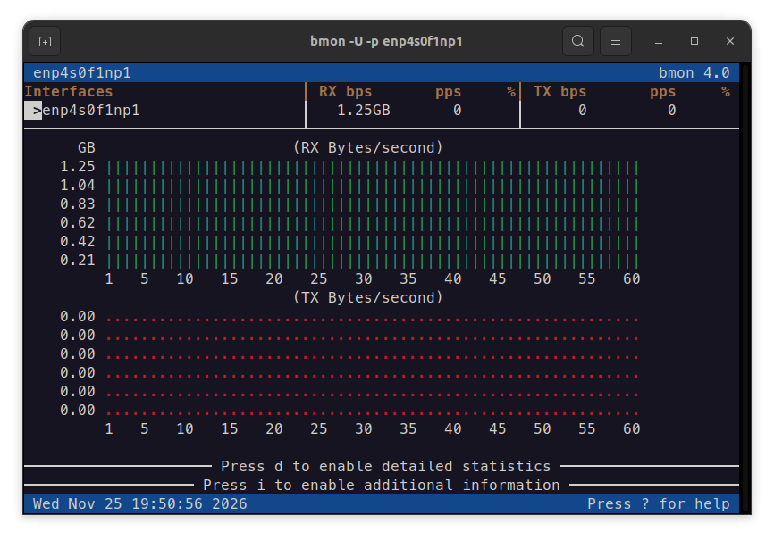
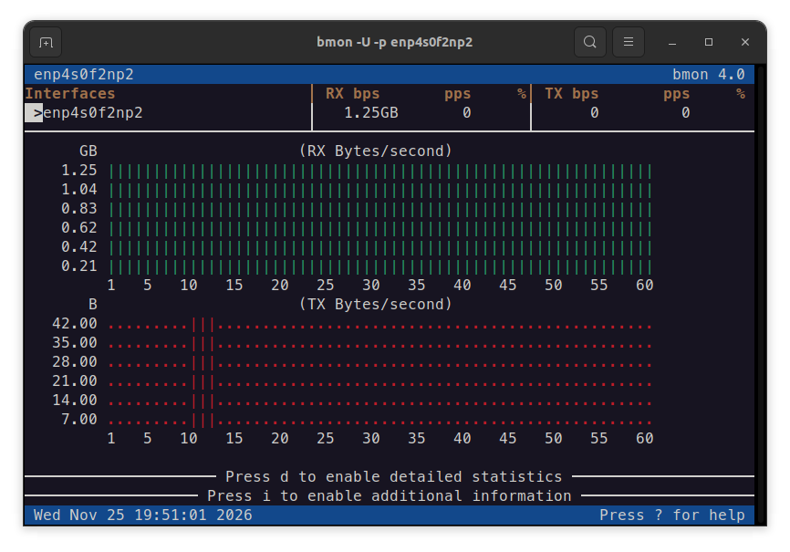
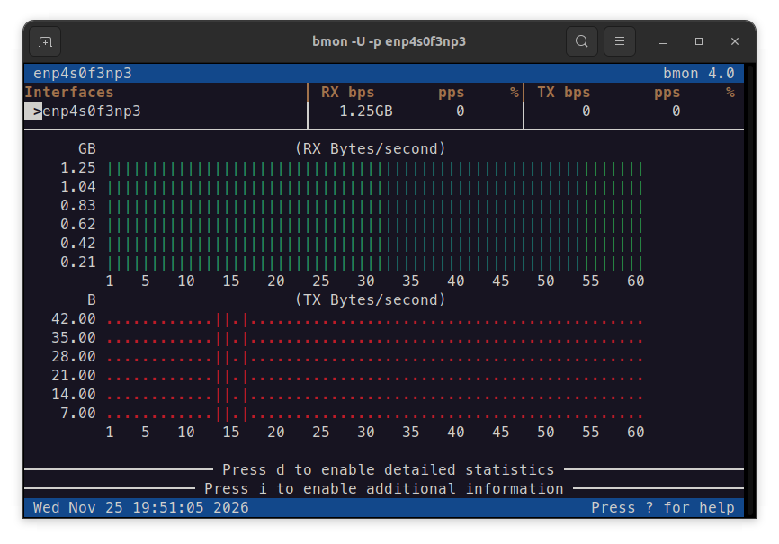
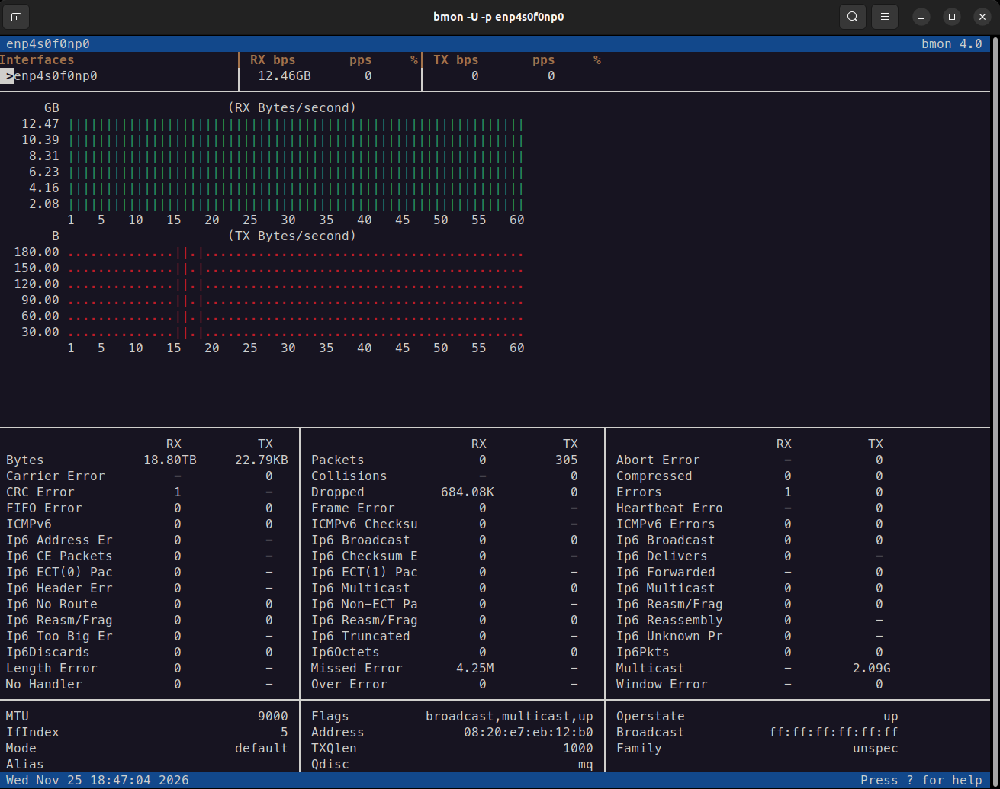

# ETAPA 2
## LFSR con 4x 10Gbps
```console
Listening on UDP port 5005, CPUs 1-1, checking 1 of every 1 packet(s)
Detected PRBS31: bit-reversed in 4-byte blocks, taps 31/28 (0 errors in the first 8960-byte packet)
    1.0s    187048 pkt/s   13.41 Gb/s  errors        0 | pkts 187072  err pkts 0  err bits 0  BER 0.00e+00
    2.0s    190557 pkt/s   13.66 Gb/s  errors        0 | pkts 377664  err pkts 0  err bits 0  BER 0.00e+00
    3.0s    190372 pkt/s   13.65 Gb/s  errors        0 | pkts 568064  err pkts 0  err bits 0  BER 0.00e+00
    4.0s    189988 pkt/s   13.62 Gb/s  errors        0 | pkts 758080  err pkts 0  err bits 0  BER 0.00e+00
    5.0s    189606 pkt/s   13.59 Gb/s  errors        0 | pkts 947712  err pkts 0  err bits 0  BER 0.00e+00
    6.0s    189283 pkt/s   13.57 Gb/s  errors        0 | pkts 1137024  err pkts 0  err bits 0  BER 0.00e+00
    7.0s    189153 pkt/s   13.56 Gb/s  errors        0 | pkts 1326208  err pkts 0  err bits 0  BER 0.00e+00
    8.0s    188513 pkt/s   13.51 Gb/s  errors        0 | pkts 1514752  err pkts 0  err bits 0  BER 0.00e+00
    9.0s    188324 pkt/s   13.50 Gb/s  errors        0 | pkts 1703104  err pkts 0  err bits 0  BER 0.00e+00
   10.0s    188899 pkt/s   13.54 Gb/s  errors        0 | pkts 1892032  err pkts 0  err bits 0  BER 0.00e+00
   11.0s    187620 pkt/s   13.45 Gb/s  errors        0 | pkts 2079680  err pkts 0  err bits 0  BER 0.00e+00
   12.0s    188256 pkt/s   13.49 Gb/s  errors        0 | pkts 2267968  err pkts 0  err bits 0  BER 0.00e+00
   13.0s    187302 pkt/s   13.43 Gb/s  errors        0 | pkts 2455296  err pkts 0  err bits 0  BER 0.00e+00
   14.0s    188131 pkt/s   13.49 Gb/s  errors        0 | pkts 2643456  err pkts 0  err bits 0  BER 0.00e+00
   15.0s    187876 pkt/s   13.47 Gb/s  errors        0 | pkts 2831360  err pkts 0  err bits 0  BER 0.00e+00
   16.0s    187554 pkt/s   13.44 Gb/s  errors        0 | pkts 3018944  err pkts 0  err bits 0  BER 0.00e+00
^C   16.5s    188189 pkt/s   13.49 Gb/s  errors        0 | pkts 3120832  err pkts 0  err bits 0  BER 0.00e+00

Packets 3120896, bytes 27963228160, checked bytes 27963228160, packets with errors 0, short packets 0
Recurrence errors 0, approx. BER 0.000e+00
No errors in 2.237e+11 checked bits: BER < 1.3e-11 (95% confidence, 3/bits)
```

 
 
 

# ETAPA 3
## Errores BER
```console
sudo mlxlink -d 04:00.0 -c | grep -E "BER|Errors"
    amBER Version                      : 8.2 
    Physical Counters and BER Info
    Effective Physical Errors          : 0
    Effective Physical BER             : 15E-255
    Raw Physical Errors Per Lane       : 2538,133,0,0
    Raw Physical BER                   : 1E-11
```
Se han enviado unos 20 Terabytes de datos para esta info



## Comprobar que el tráfico llega al puerto correcto
```console
sudo tcpdump -i $IF -nn -c 5 -X udp port 5005 | head -40
tcpdump: verbose output suppressed, use -v[v]... for full protocol decode
listening on enp4s0f0np0, link-type EN10MB (Ethernet), snapshot length 262144 bytes
18:34:33.353340 IP 10.0.0.2.5005 > 10.0.0.1.5005: UDP, length 8960
	0x0000:  4500 231c 1234 0000 4011 319b 0a00 0002  E.#..4..@.1.....
	0x0010:  0a00 0001 138d 138d 2308 01c8 4e1c d6d0  ........#...N...
	0x0020:  6925 bac5 a26f ae9f 3d06 af1a 6e80 0b25  i%...o..=...n..%
	0x0030:  06c0 5b90 ff1f 0588 e3c8 24ad d4f2 7dbd  ..[.......$...}.
	0x0040:  d7c7 7875 a8d6 ea95 d045 8fbe c584 9bc3  ..xu.....E......
	0x0050:  44c0 53bb df56 333c 9e17 914a 5b93 0a89  D.S..V3<...J[...
	0x0060:  a12c a489 f4d9 74bf c7ba 87c3 0d75 c01f  .,....t......u..
	0x0070:  3623 a9da 3510 f43a 0348 b858 dbb2 d17a  6#..5..:.H.X...z
	0x0080:  9e75 f36a ac87 d56b 3d52 a830 2768 2f11  .u.j...k=R.0'h/.
	0x0090:  4b86 cb7e 963f 4495 77fc cdac 5094 e2bd  K..~.?D.w...P...
	0x00a0:  059a 1dae ff1a fe50 d593 6333 731a 79ca  .......P..c3s.y.
	0x00b0:  07a5 b1e0 a4af f50f c219 aa92 8d48 2f88  .............H/.
	0x00c0:  d232 262d 28d8 7dfd 4b1e ce38 04b7 f203  .2&-(.}.K..8....
	0x00d0:  1243 e3b6 ec16 b92e 0f13 bc82 0ba4 4e81  .C............N.
	0x00e0:  49d0 e93f 4d3a 1da7 fbca c83d 9c29 8d4a  I..?M:.....=.).J
	0x00f0:  ac59 6496 c2fa dd65 f2aa 73f9 0e3d 7847  .Yd....e..s..=xG
	0x0100:  ed91 78a0 ab65 0750 afcf 6d33 e6e0 794a  ..x..e.P..m3..yJ
	0x0110:  b91d dc7b e701 1e15 ab6d eca5 4d8d 95ef  ...{.....m..M...
	0x0120:  e989 3ec6 e29b 03bb 5477 12f5 8507 818e  ..>.....Tw......
	0x0130:  7680 6464 f8bf 4fb0 713c 963c b103 d358  v.dd..O.q<.<...X
	0x0140:  8aed 9e68 769d d322 eac1 d76f c656 e1b0  ...hv.."...o.V..
	0x0150:  d685 d42e 3a9b 9e4b a708 7716 615e 96a6  ....:..K..w.a^..
	0x0160:  dd21 9aaf 734b 7774 ea32 6ab1 f06e 86bc  .!..sKwt.2j..n..
	0x0170:  d5f9 6475 e163 7931 3930 1558 6e83 feb3  ..du.cy190.Xn...
	0x0180:  a264 1cd1 2f6b a5c5 59cf 74a9 a1f2 1574  .d../k..Y.t....t
	0x0190:  0b71 01ea 1278 db2b 48ce 7326 e93c 6652  .q...x.+H.s&.<fR
	0x01a0:  46fc 9405 fbf1 e5ed aa55 709d 19fa 871a  F........Up.....
	0x01b0:  6c8e bf48 941b 67df acc8 5d45 f43b 17b2  l..H..g...]E.;..
	0x01c0:  c783 b73c 7252 d1d8 07a1 451e 5bc2 0437  ...<rR....E.[..7
	0x01d0:  4cbb 7fd8 a018 070c d05a 4924 8b98 4d13  L........ZI$..M.
	0x01e0:  2de5 e97e 7d39 9da3 a311 3e50 8b6c fc17  -..~}9....>P.l..
	0x01f0:  2d4f 1c13 a6b2 1301 0b51 1380 c95e 93e4  -O.......Q...^..
	0x0200:  bb7a 9ac6 4307 65e0 165b b09d 374c 8a1a  .z..C.e..[..7L..
	0x0210:  0396 09a5 241a a42f 4bb7 af82 7cfb 2598  ....$../K...|.%.
	0x0220:  eaaa 6ff7 62e6 302a b046 4a6f 4369 16cf  ..o.b.0*.FJoCi..
	0x0230:  5f06 131f 977f 5aa5 3e4e 1742 b532 da5f  _.....Z.>N.B.2._
	0x0240:  98b5 a8fa 5398 d0e3 de9a 8c9d f39a 52ac  ....S.........R.
	0x0250:  9c41 b30b 3ee9 ae00 a7b9 4212 5423 10be  .A..>.....B.T#..
	0x0260:  17d9 fe18 130c 477e da80 dfb1 2889 7343  ......G~....(.sC
```
## Parsear el LFSR y comprobar que llega bien (da muchos errores porque el enlace es demasiado rapido para un flujo de datos solo)
```console
sudo ./udp_lfsr_rx

Listening on UDP port 5005, 1 thread(s), checking 1 of every 1 packet(s)
Detected PRBS31: bit-reversed in 64-byte blocks, taps 31/28 (0 errors in the first 8960-byte packet)
    1.0s    453059 pkt/s   32.48 Gb/s  errors        0 | pkts 453120  err pkts 0  err bits 0  BER 0.00e+00
    2.0s    455093 pkt/s   32.62 Gb/s  errors        0 | pkts 908288  err pkts 0  err bits 0  BER 0.00e+00
    3.0s    451385 pkt/s   32.36 Gb/s  errors        0 | pkts 1359744  err pkts 0  err bits 0  BER 0.00e+00
    4.0s    443773 pkt/s   31.81 Gb/s  errors        0 | pkts 1803584  err pkts 0  err bits 0  BER 0.00e+00
    5.0s    447297 pkt/s   32.06 Gb/s  errors        0 | pkts 2250944  err pkts 0  err bits 0  BER 0.00e+00
    6.0s    447039 pkt/s   32.04 Gb/s  errors        0 | pkts 2698048  err pkts 0  err bits 0  BER 0.00e+00
    7.0s    455550 pkt/s   32.65 Gb/s  errors        0 | pkts 3153664  err pkts 0  err bits 0  BER 0.00e+00
    8.0s    447808 pkt/s   32.10 Gb/s  errors        0 | pkts 3601536  err pkts 0  err bits 0  BER 0.00e+00
    9.0s    447421 pkt/s   32.07 Gb/s  errors        0 | pkts 4049024  err pkts 0  err bits 0  BER 0.00e+00
   10.0s    447740 pkt/s   32.09 Gb/s  errors        0 | pkts 4496832  err pkts 0  err bits 0  BER 0.00e+00
   11.0s    449661 pkt/s   32.23 Gb/s  errors        0 | pkts 4946560  err pkts 0  err bits 0  BER 0.00e+00
   12.0s    449215 pkt/s   32.20 Gb/s  errors        0 | pkts 5395840  err pkts 0  err bits 0  BER 0.00e+00
   13.0s    448061 pkt/s   32.12 Gb/s  errors        0 | pkts 5843968  err pkts 0  err bits 0  BER 0.00e+00
   14.0s    449345 pkt/s   32.21 Gb/s  errors        0 | pkts 6293376  err pkts 0  err bits 0  BER 0.00e+00
   15.0s    449088 pkt/s   32.19 Gb/s  errors        0 | pkts 6742528  err pkts 0  err bits 0  BER 0.00e+00
   16.0s    449914 pkt/s   32.25 Gb/s  errors        0 | pkts 7192512  err pkts 0  err bits 0  BER 0.00e+00
   17.0s    440833 pkt/s   31.60 Gb/s  errors        0 | pkts 7633408  err pkts 0  err bits 0  BER 0.00e+00
^C   17.2s    445280 pkt/s   31.92 Gb/s  errors        0 | pkts 7735040  err pkts 0  err bits 0  BER 0.00e+00

Packets 7735104, bytes 69306531840, checked bytes 69306531840, packets with errors 0, short packets 0
Recurrence errors 0, approx. BER 0.000e+00
No errors in 5.545e+11 checked bits: BER < 5.4e-12 (95% confidence, 3/bits)

```
## Aumentar el anillo de la cola de recepción (RX) mejora un poco la velocidad, sigue sin ser suficiente
```console
sudo ethtool -G enp4s0f0np0 rx 8192          # anillo de RX más grande
sudo ethtool -C enp4s0f0np0 adaptive-rx on
``

```console
sudo ./udp_lfsr_rx

Listening on UDP port 5005, 1 thread(s), checking 1 of every 1 packet(s)
Detected PRBS31: bit-reversed in 64-byte blocks, taps 31/28 (0 errors in the first 8960-byte packet)
    1.0s    511348 pkt/s   36.65 Gb/s  errors        0 | pkts 511424  err pkts 0  err bits 0  BER 0.00e+00
    2.0s    512621 pkt/s   36.74 Gb/s  errors        0 | pkts 1024128  err pkts 0  err bits 0  BER 0.00e+00
    3.0s    498681 pkt/s   35.75 Gb/s  errors        0 | pkts 1522880  err pkts 0  err bits 0  BER 0.00e+00
    4.0s    496058 pkt/s   35.56 Gb/s  errors        0 | pkts 2019008  err pkts 0  err bits 0  BER 0.00e+00
    5.0s    495401 pkt/s   35.51 Gb/s  errors        0 | pkts 2514496  err pkts 0  err bits 0  BER 0.00e+00
    6.0s    490928 pkt/s   35.19 Gb/s  errors        0 | pkts 3005504  err pkts 0  err bits 0  BER 0.00e+00
    7.0s    489972 pkt/s   35.12 Gb/s  errors        0 | pkts 3495552  err pkts 0  err bits 0  BER 0.00e+00
    8.0s    494577 pkt/s   35.45 Gb/s  errors        0 | pkts 3990208  err pkts 0  err bits 0  BER 0.00e+00
    9.0s    492578 pkt/s   35.31 Gb/s  errors        0 | pkts 4482880  err pkts 0  err bits 0  BER 0.00e+00
   10.0s    486647 pkt/s   34.88 Gb/s  errors        0 | pkts 4969600  err pkts 0  err bits 0  BER 0.00e+00
   11.0s    489647 pkt/s   35.10 Gb/s  errors        0 | pkts 5459328  err pkts 0  err bits 0  BER 0.00e+00
   12.0s    489007 pkt/s   35.05 Gb/s  errors        0 | pkts 5948416  err pkts 0  err bits 0  BER 0.00e+00
   13.0s    491569 pkt/s   35.24 Gb/s  errors        0 | pkts 6440064  err pkts 0  err bits 0  BER 0.00e+00
   14.0s    479867 pkt/s   34.40 Gb/s  errors        0 | pkts 6920000  err pkts 0  err bits 0  BER 0.00e+00
   15.0s    488825 pkt/s   35.04 Gb/s  errors        0 | pkts 7408896  err pkts 0  err bits 0  BER 0.00e+00
   16.0s    490042 pkt/s   35.13 Gb/s  errors        0 | pkts 7899008  err pkts 0  err bits 0  BER 0.00e+00
   17.0s    489651 pkt/s   35.10 Gb/s  errors        0 | pkts 8388736  err pkts 0  err bits 0  BER 0.00e+00
   18.0s    479675 pkt/s   34.38 Gb/s  errors        0 | pkts 8868480  err pkts 0  err bits 0  BER 0.00e+00
^C   18.3s    479874 pkt/s   34.40 Gb/s  errors        0 | pkts 9023680  err pkts 0  err bits 0  BER 0.00e+00

Packets 9023744, bytes 80852746240, checked bytes 80852746240, packets with errors 0, short packets 0
Recurrence errors 0, approx. BER 0.000e+00
No errors in 6.468e+11 checked bits: BER < 4.6e-12 (95% confidence, 3/bits)
```

## 100 Gbps aumentando a 8 flujos UDP y poniendo un flujo por cola

```console
# 1. Que haya al menos 8 colas, y en qué nodo NUMA está la tarjeta
ethtool -l $IF
cat /sys/class/net/$IF/device/numa_node; lscpu | grep NUMA

# 2. Fijar cada flujo a una cola (sin esto, RSS reparte por hash y dos flujos pueden caer en la misma cola)
sudo ethtool -K $IF ntuple on
for i in $(seq 0 7); do sudo ethtool -N $IF flow-type udp4 dst-port $((5005+i)) action $i; done
ethtool -n $IF                                   # muestra las reglas

# 3. Ver en qué CPU procesa cada cola su interrupción
grep mlx5_comp /proc/interrupts | head -8

# 4. Ejecutar el programa con 8 núcleos
sudo sysctl -w net.core.rmem_max=268435456
sudo ./udp_lfsr_rx -j 8 -c 8 -t 60
```

```console
Listening on UDP ports 5005-5012, one thread per port, CPUs 8-15, checking 1 of every 1 packet(s)
Detected PRBS31: bit-reversed in 64-byte blocks, taps 31/28 (0 errors in the first 8960-byte packet)
    1.0s   1383095 pkt/s   99.14 Gb/s  errors        0 | pkts 1383238  err pkts 0  err bits 0  BER 0.00e+00
         per port Gb/s: 5005:12.4 5006:12.4 5007:12.4 5008:12.4 5009:12.4 5010:12.4 5011:12.4 5012:12.4
    2.0s   1384184 pkt/s   99.22 Gb/s  errors        0 | pkts 2767607  err pkts 0  err bits 0  BER 0.00e+00
         per port Gb/s: 5005:12.4 5006:12.4 5007:12.4 5008:12.4 5009:12.4 5010:12.4 5011:12.4 5012:12.4
    3.0s   1384157 pkt/s   99.22 Gb/s  errors        0 | pkts 4151932  err pkts 0  err bits 0  BER 0.00e+00
         per port Gb/s: 5005:12.4 5006:12.4 5007:12.4 5008:12.4 5009:12.4 5010:12.4 5011:12.4 5012:12.4
    4.0s   1384208 pkt/s   99.22 Gb/s  errors        0 | pkts 5536313  err pkts 0  err bits 0  BER 0.00e+00
         per port Gb/s: 5005:12.4 5006:12.4 5007:12.4 5008:12.4 5009:12.4 5010:12.4 5011:12.4 5012:12.4
    5.0s   1384211 pkt/s   99.22 Gb/s  errors        0 | pkts 6920689  err pkts 0  err bits 0  BER 0.00e+00
         per port Gb/s: 5005:12.4 5006:12.4 5007:12.4 5008:12.4 5009:12.4 5010:12.4 5011:12.4 5012:12.4
    6.0s   1384213 pkt/s   99.22 Gb/s  errors        0 | pkts 8305121  err pkts 0  err bits 0  BER 0.00e+00
         per port Gb/s: 5005:12.4 5006:12.4 5007:12.4 5008:12.4 5009:12.4 5010:12.4 5011:12.4 5012:12.4
    7.0s   1384209 pkt/s   99.22 Gb/s  errors        0 | pkts 9689499  err pkts 0  err bits 0  BER 0.00e+00
         per port Gb/s: 5005:12.4 5006:12.4 5007:12.4 5008:12.4 5009:12.4 5010:12.4 5011:12.4 5012:12.4
    8.0s   1384341 pkt/s   99.23 Gb/s  errors        0 | pkts 11074017  err pkts 0  err bits 0  BER 0.00e+00
         per port Gb/s: 5005:12.4 5006:12.4 5007:12.4 5008:12.4 5009:12.4 5010:12.4 5011:12.4 5012:12.4
    9.0s   1384093 pkt/s   99.21 Gb/s  errors        0 | pkts 12458290  err pkts 0  err bits 0  BER 0.00e+00
         per port Gb/s: 5005:12.4 5006:12.4 5007:12.4 5008:12.4 5009:12.4 5010:12.4 5011:12.4 5012:12.4
   10.0s   1384287 pkt/s   99.23 Gb/s  errors        0 | pkts 13842752  err pkts 0  err bits 0  BER 0.00e+00
         per port Gb/s: 5005:12.4 5006:12.4 5007:12.4 5008:12.4 5009:12.4 5010:12.4 5011:12.4 5012:12.4
   11.0s   1384049 pkt/s   99.21 Gb/s  errors        0 | pkts 15226974  err pkts 0  err bits 0  BER 0.00e+00
         per port Gb/s: 5005:12.4 5006:12.4 5007:12.4 5008:12.4 5009:12.4 5010:12.4 5011:12.4 5012:12.4
   12.0s   1384262 pkt/s   99.22 Gb/s  errors        0 | pkts 16611401  err pkts 0  err bits 0  BER 0.00e+00
         per port Gb/s: 5005:12.4 5006:12.4 5007:12.4 5008:12.4 5009:12.4 5010:12.4 5011:12.4 5012:12.4
   13.0s   1384275 pkt/s   99.22 Gb/s  errors        0 | pkts 17995833  err pkts 0  err bits 0  BER 0.00e+00
         per port Gb/s: 5005:12.4 5006:12.4 5007:12.4 5008:12.4 5009:12.4 5010:12.4 5011:12.4 5012:12.4
   14.0s   1384166 pkt/s   99.22 Gb/s  errors        0 | pkts 19380182  err pkts 0  err bits 0  BER 0.00e+00
         per port Gb/s: 5005:12.4 5006:12.4 5007:12.4 5008:12.4 5009:12.4 5010:12.4 5011:12.4 5012:12.4
   15.0s   1384155 pkt/s   99.22 Gb/s  errors        0 | pkts 20764560  err pkts 0  err bits 0  BER 0.00e+00
         per port Gb/s: 5005:12.4 5006:12.4 5007:12.4 5008:12.4 5009:12.4 5010:12.4 5011:12.4 5012:12.4
^C   15.9s   1384231 pkt/s   99.22 Gb/s  errors        0 | pkts 22076780  err pkts 0  err bits 0  BER 0.00e+00
         per port Gb/s: 5005:12.4 5006:12.4 5007:12.4 5008:12.4 5009:12.4 5010:12.4 5011:12.4 5012:12.4

Port 5005: packets 2759326, errors 0, packets with errors 0
Port 5006: packets 2759643, errors 0, packets with errors 0
Port 5007: packets 2759739, errors 0, packets with errors 0
Port 5008: packets 2759693, errors 0, packets with errors 0
Port 5009: packets 2759740, errors 0, packets with errors 0
Port 5010: packets 2759651, errors 0, packets with errors 0
Port 5011: packets 2759713, errors 0, packets with errors 0
Port 5012: packets 2759650, errors 0, packets with errors 0

Packets 22077155, bytes 197811308800, checked bytes 197811308800, packets with errors 0, short packets 0
Recurrence errors 0, approx. BER 0.000e+00
No errors in 1.582e+12 checked bits: BER < 1.9e-12 (95% confidence, 3/bits)

```
